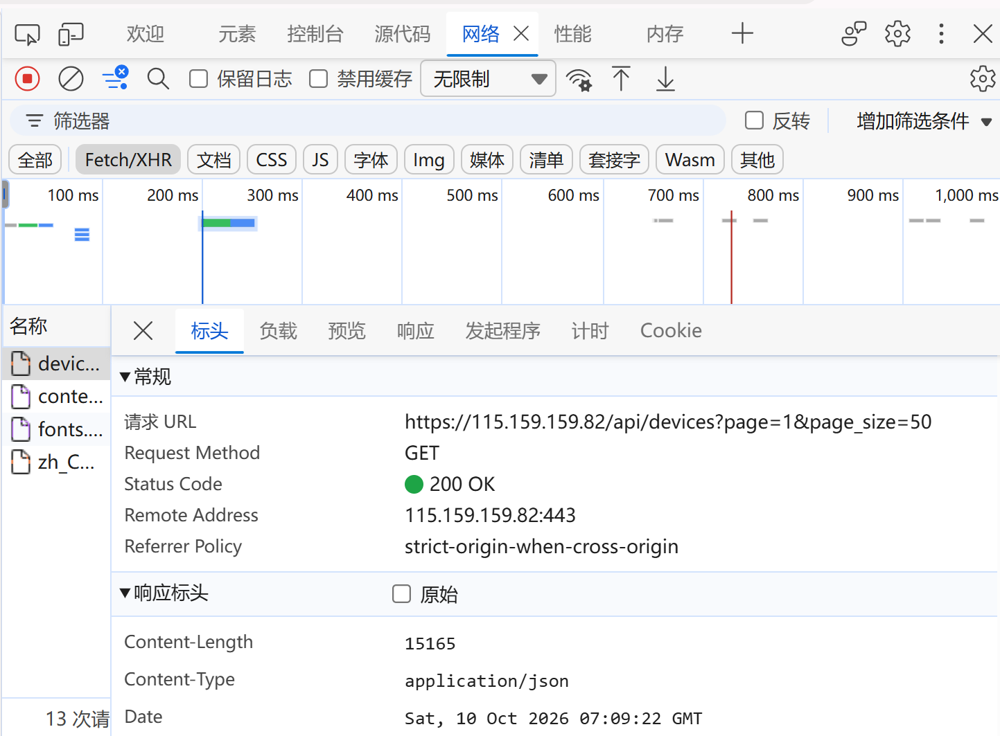
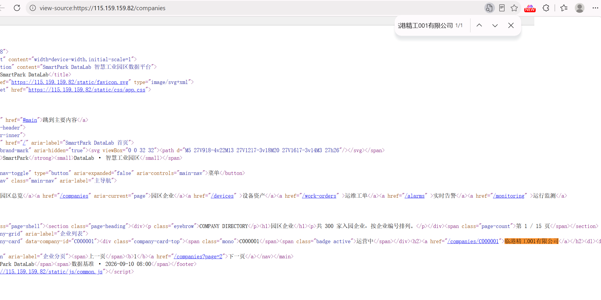
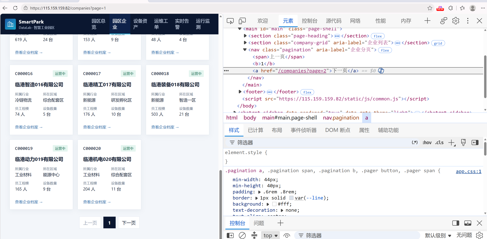
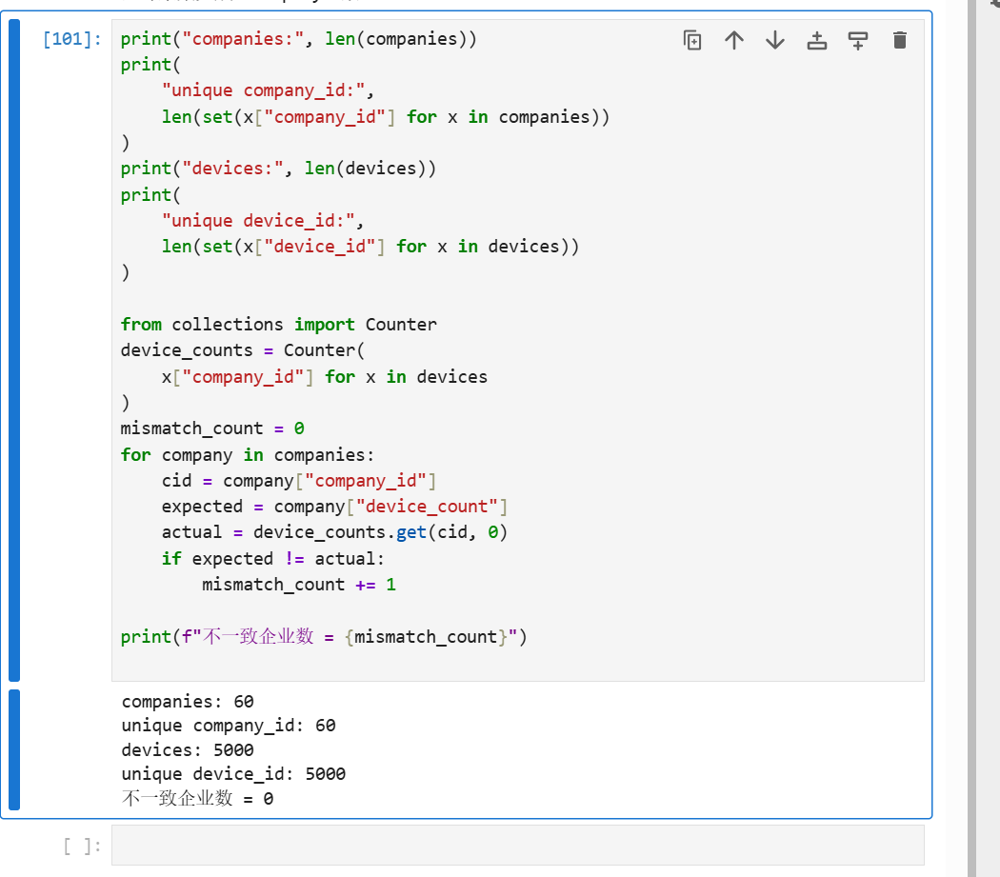

# Lab 1 实验报告

## 学生信息

- **姓名：** 赵昱
- **学号：** 112404260115
- **班级：** 数据1241班
- **GitHub 用户名：** zoey7027
- **仓库地址：** https://github.com/zoey7027/bigdata-collection-labs-112404260115

> 文件位置：`lab01/REPORT.md`  
> 完整代码保存在 `lab1_html_api.ipynb`。  
> 本报告只填写关键发现、关键代码、结果和指定截图，**不要把整份 Notebook 复制进来**。

---

# 任务 1：判断数据加载方式

## 1.1 Device：判断动态加载并找到 API

### 判断结果

- 页面：`/devices`
- 数据加载方式： 动态加载
- 判断依据：查看源代码中不能搜索到页面上的设备名称，在 Network 的 Fetch/XHR 中能找到返回设备数据的请求。

请用 1～2 句话说明：

1. 在“查看网页源代码”中是否能搜索到页面上的设备名称；
2. 在 Network 的 Fetch/XHR 中是否找到返回设备数据的请求。

### API 信息

- Request URL：https://115.159.159.82/api/devices
- Request Method：GET
- Query 参数：page=1&page_size=50


### 【截图 1】Device API 发现证据



文件名：

```text
images/01_device_api.png
```

**截图内容必须是浏览器 DevTools，不是 Jupyter 代码。**

截图中应能看清：

1. 浏览器的 **Network** 面板；
2. 已选中真正返回设备列表的 Fetch/XHR 请求；
3. 右侧 **Headers** 中的 Request URL；
4. Query String Parameters（或 URL 中的分页参数）。

> 不要截整个桌面；尽量裁剪到 Network 请求和右侧 Headers 区域。

插入：

```markdown

```

---

## 1.2 Company：判断静态加载

- 页面：`/companies`
- 数据加载方式：静态加载 
- 判断依据：在查看网页源代码能搜索到页面中真实显示的企业名称。

请说明：使用“右键 → 查看网页源代码”后，是否能搜索到页面中真实显示的企业名称。

### 【截图 2】Company 静态加载证据

文件名：

```text
images/02_company_source.png
```

**截图内容必须是“查看网页源代码”页面，不是 Elements，也不是 Jupyter。**

截图中应能看清：

1. 浏览器正在显示 `/companies` 的网页源代码；
2. 使用 `Ctrl + F` 搜索一个页面中真实存在的企业名称；
3. 源代码中能看到该企业名称或对应企业记录。

插入：

```markdown

```

---

# 任务 2：Device API 分页采集

## 2.1 API 分页结构

填写你实际从 JSON 中观察到的字段：

| 含义 | JSON 字段 |
|---|---|
| 当前页 |page|
| 每页条数 |page_size|
| 设备总数 |total|
| 设备列表 |items|

---

## 2.2 关键代码

只填写分页采集的核心部分，不要粘贴整个 Notebook。

```python
# 从第一页响应中读取分页信息
total = data["total"]
page_size = data["page_size"]

total_pages = (total + page_size - 1) // page_size

devices = []

for page in range(1, total_pages + 1):
    r = requests.get(
        api_url,
        params={
            "page": page,
            "page_size": page_size
        },
        timeout=10
    )

    page_data = r.json()
    page_items = page_data["items"]
    devices.extend(page_items)

print("device count:", len(devices))
```

---

## 2.3 采集结果

- 每页条数：50
- 设备总数：5000
- 程序计算得到的总页数：100
- 最终采集设备数：5000
- 唯一 `device_id` 数：5000

回答：

> 为什么总页数应由 API 返回的 `total` 和 `page_size` 计算，而不是直接在代码里写死？

答：后端设备总数`total`会动态增减，直接写死总页数，当设备数量变化时代码会采集不全或者请求无效页码。通过接口返回的`total`和`page_size`实时计算总页数，可以自动适配数据量、每页条数的变动，保证采集完整，提升代码通用性。

---

# 任务 3：Company HTML 解析

## 3.1 企业记录 Selector

- 企业记录 selector：.company-card
- 第 1 页企业记录数：20

说明为什么选择这个 selector：

- 主要使用了 `id / class / data-* / 父子层级` 中的哪一种？
- 是否参考过浏览器 Copy selector 或 AI？
- 最终为什么采用现在这个写法？

答：主要使用了class，参考过浏览器 Copy selector，但原结果过长且带`nth-child`不稳定。`.company-card`简短，是每条企业记录最外层`<article>`的统一 class，且带`data-company-id`属性，不依赖元素顺序。

---

## 3.2 关键代码

只填写“记录定位 + 一条记录的关键字段”。

```python
cards = soup.select(".company-card")

card = cards[0]

company_id = card.select_one(".company-card-top .mono").get_text(strip=True)
name = card.select_one("h2 a").get_text(strip=True)
status = card.select_one(".company-card-top .badge").get_text(strip=True)
```

行业、区域、设备数量使用 `dt/dd` 结构后，请写出你最终如何得到：

```python
industry = details["所属行业"]
zone = details["所在区域"]
device_count = int(details["设备数量"].replace("台","").strip())
```

---

## 3.3 字段来源说明

任选 **2 个字段**说明：

1. 字段：device_count
   - 来自：文本 
   - 使用的方法：遍历`dl>div`，把 dt、dd 读取存入 details 字典；取出`details["设备数量"]`
2. 字段：industry
   - 来自：文本
   - 使用的方法：遍历`dl>div`解析 dt-dd 存入 details 字典，读取`details["所属行业"]`

---

# 任务 4：Company “下一页”分页

## 4.1 下一页元素

- “下一页” selector：a:contains('下一页')
- 第 1 页 `href` 示例：/companies?page=2

### 【截图 3】Company “下一页”元素

文件名：

```text
images/03_company_next.png
```

**截图内容必须是浏览器 DevTools 的 Elements 面板。**

截图中应能看清：

1. 页面底部“下一页”对应的 `<a>` 元素被选中；
2. 该元素的 `class`、`href` 等关键属性；
3. 能判断你为什么使用当前 selector。

> 不需要截 Python 代码；这一张图只证明你找到了正确的 DOM 元素。

插入：

```markdown

```

---

## 4.2 关键代码

```python
next_link = soup.select_one("a:contains('下一页')")
next_href = next_link.get("href")
next_url = urljoin(
    current_url,
    next_href
)
```

再用 2～3 句话说明：

> 你的程序如何完成“当前页 → 找下一页 href → 请求下一页 → 再解析”的循环？

答：程序请求当前页面，解析得到`soup`并提取本页企业数据；再通过 selector 找到下一页链接，读取`href`，使用`urljoin`生成完整的下一页 URL，赋值给`current_url`；循环再次发起请求，重复解析流程，采集够 3 页后终止。

---

## 4.3 三页采集结果

| 页码 | 企业数 |
|---|---:|
| 1 |20|
| 2 |20|
| 3 |20|
| **合计** |60|

- 唯一 `company_id` 数：60

---

# 任务 5：结果验证

## 5.1 最终结果

| 检查项 | 结果 |
|---|---:|
| Company 总数 |60|
| 唯一 `company_id` |60|
| Device 总数 |5000|
| 唯一 `device_id` |5000|
| Company–Device 不一致企业数 |0|

### 【截图 4】最终验证结果

文件名：

```text
images/04_validation.png
```

**截图内容必须是 JupyterLab 的运行结果，不是代码截图，也不是浏览器截图。**

截图中应能同时看清以下输出：

```text
Company 总数 60
唯一 company_id 数 60
Device 总数 5000
唯一 device_id 数 5000
Company–Device 不一致企业数 0
```

建议把这几个 `print()` 放在同一个 Notebook 单元格中运行后截图。

插入：

```markdown

```

---

## 5.2 一致性检查关键代码

只填写最关键的比较逻辑：

```python
from collections import Counter

device_counts = Counter(
    x["company_id"] for x in devices
)

mismatch_count = 0

for company in companies:
    cid = company["company_id"]
    expected = company["device_count"]
    actual = device_counts.get(cid, 0)
    if expected != actual:
        mismatch_count += 1
```

回答：

> 为什么 `status_code == 200` 仍然不能说明“数据已经采集正确”？

答：status_code == 200 只说明这一次 HTTP 请求被服务器成功处理并返回了响应，它既不保证返回的就是我们想要的数据，也不保证数据完整。例如：分页只请求了第 1 页（200，但只有 20/50 条）、URL 写错却返回了另一个正常页面（200）、接口返回了空的 items、字段名变了导致取不到值、以及两个数据源的设备数量对不上——这些情况下状态码都仍然是 200。所以必须在 200 的基础上继续检查条数是否正确、ID 是否唯一、Company 与 Device 的数量是否一致。

---

# 任务 6：保存采集结果

确认已经生成：

```text
data/companies.json
data/devices.json
```

填写：

- `companies.json`：已生成 
- `devices.json`：已生成 

不需要截图 JSON 全文，也不需要把 JSON 内容复制到报告。

---

# 实验结论

用 **80～150 字**总结：

1. 静态加载与动态加载页面的处理方式有什么不同；
2. HTML “下一页”分页和 API `page` 分页有什么不同；
3. 你使用了哪些方法验证采集结果。

答：本次实验完成企业与设备两类数据采集。静态加载页面的数据随初始 HTML 一起返回，requests 拿到源码后用 BeautifulSoup + CSS Selector 解析即可；动态加载页面的初始源码中没有数据，需要在 Network 中找到对应 API，直接请求其 JSON 接口。HTML“下一页”分页要解析页面里的链接、用 urljoin 拼出下一页地址再请求；API 分页只需修改 page 参数逐页请求，还能按 total 与 page_size 自动计算总页数。采集完成后通过统计条数、ID 去重和 Company–Device 数量一致性比对进行验证，通过后保存为 JSON 文件。

---

# 8. 完成前自检（已逐条核对）

```text
☑ 会用“查看网页源代码”判断静态 / 动态加载      （任务 1：1.1 / 1.2 判断依据 + 截图 2）
☑ 能在 Network 中找到 Device API               （任务 1：API 信息 + 截图 1）
☑ 能读懂 API 分页结构并自动计算总页数           （任务 2：page/page_size/total/items + 100 页）
☑ Device 共采集 5000 条，device_id 无重复      （任务 2.3 + 截图 4）
☑ 能设计简洁、稳定的 Company CSS Selector      （任务 3.1：.company-card）
☑ 能定位“下一页”并读取 href                    （任务 4.1 / 4.2 + 截图 3）
☑ Company 连续采集 3 页，共 60 条              （任务 4.3：20+20+20）
☑ company_id 无重复                            （任务 4.3：60）
☑ Company–Device 数量检查通过                  （任务 5.1：不一致企业数 0 + 截图 4）
☑ 已保存 companies.json 和 devices.json        （任务 6：两个文件均已生成）
```

> 提交前仍需手动补齐：
>
> 1. **学生信息**（姓名 / 学号 / 班级 / GitHub 用户名 / 仓库地址）目前为空；
> 2. 确认 `lab01/` 目录结构完整：`lab1_html_api.ipynb`、`REPORT.md`、`data/`、`images/`（4 张截图）；
> 3. 在 JupyterLab 中 Restart Kernel → Run All 一遍，确认无报错后再 commit。
