# 实验二报告：房源采集与 MySQL 存储

- 班级：数据1241
- 姓名：赵昱
- 学号：112404260115
- 实验日期：2026.10.27
- GitHub 仓库链接：https://github.com/zoey7027/bigdata-collection-labs-112404260115
- 源码文件名：`anjuke.ipynb`
- 数据库与表：`smartpark_lab.houseinfo`
- 数据来源：在线教学站 http://www.bspider.top/anjuke/
- 访问时间及结果：2026-11-06 14:19—14:35 多次请求，均返回正常房源列表页（HTTP 200，未出现访问验证页）
- 快照文件来源与文件名（在线实验可写“不适用”）：不适用（在线采集成功，未使用网页快照）

> 填写要求：截图放在 `images/` 中，在对应位置插入图片。代码截图要显示文件名、行号或单元位置，用红框标出关键代码，每项写2—3句话解释。只截最终结果或只贴 AI 生成的文字，不能代替实验过程。未完成的项目写明原因，不填写预期结果，不展示个人账号密码。

## 第一阶段：MySQL Docker 更新与启动

- 本次是否需要更新：已完成更新（上课前按 L05 更新包完成，实验当天直接沿用该教学数据卷，未重复更新）
- 更新或启动遇到的问题：无。按顺序双击 `start-course.bat`、`start-mysql.bat`、`mysql-console.bat`，三次均正常，MySQL 终端输入密码 `123456` 后进入 `mysql>`。

### 启动环境与建表

依次使用 `start-course.bat`、`start-mysql.bat`、`mysql-console.bat` 启动课程环境、数据库和 MySQL 终端。

**截图：** MySQL 启动成功提示，以及终端中 `USE smartpark_lab`、`SHOW TABLES`、`DESCRIBE houseinfo` 的执行结果。可分图。

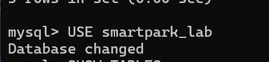

用 `USE smartpark_lab;` 把当前会话切到课程数据库，回显 `Database changed` 表示切换成功。之后所有建表、查询都作用在这个库上，不会误改其他数据库。

用 `SHOW TABLES;` 列出当前库中的表，用于确认课程环境已就绪、`houseinfo` 表是否已经存在。表不存在时先执行建表 SQL，避免后续入库时报“表不存在”。

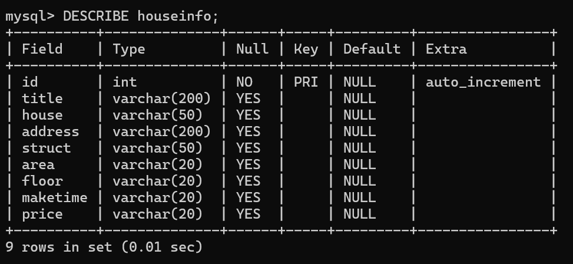

`DESCRIBE houseinfo;` 返回 9 行：`id` 是 `int`、主键、`auto_increment`，其余 8 列都是 `varchar`。面积、楼层、单价之所以用 `varchar` 而不是数值类型，是为了原样保留网页上的单位和文字（如 `89.9㎡`、`低层(共27层)`、`16465元/㎡`），CSV 与数据库内容才能保持一致。

说明：当前使用哪个数据库？`id` 和8个房源字段分别保存什么？

答：当前使用的数据库：smartpark_lab，`id`：自增长主键，由 MySQL 自动生成，作为 houseinfo 表每条房源记录的唯一标识，不是网页采集来的数据。

1. title：房源的卖点标题
2. house：楼盘名称
3. address：房源地址
4. struct：户型
5. area：建筑面积，保留面积单位
6. floor：楼层信息，注意不要取成朝向
7. maketime：建造年代，缺失数据存入空字符串
8. price：房源每平方米的单价

## 第二阶段：房源采集与 CSV 数据存储

### 1. 网页分析与房源解析

#### 选择器是怎样得到的

在 Chrome 中按 F12，使用 **Elements → Copy → Copy selector**。选一个字段，记录从完整路径到相对选择器的过程。

- 选择的字段：title
- 复制的原始选择器：#__layout > div > section > section.list-main > section.list-left > section:nth-child(4) > div:nth-child(1) > a > div.property-content > div.property-content-detail > div.property-content-title > h3
- 一条房源的父容器选择器：div.property-content
- 最终使用的相对选择器：div.property-content-title > h3

**截图：** 框出该字段的 HTML 节点和房源父容器，展示选择器的匹配结果。

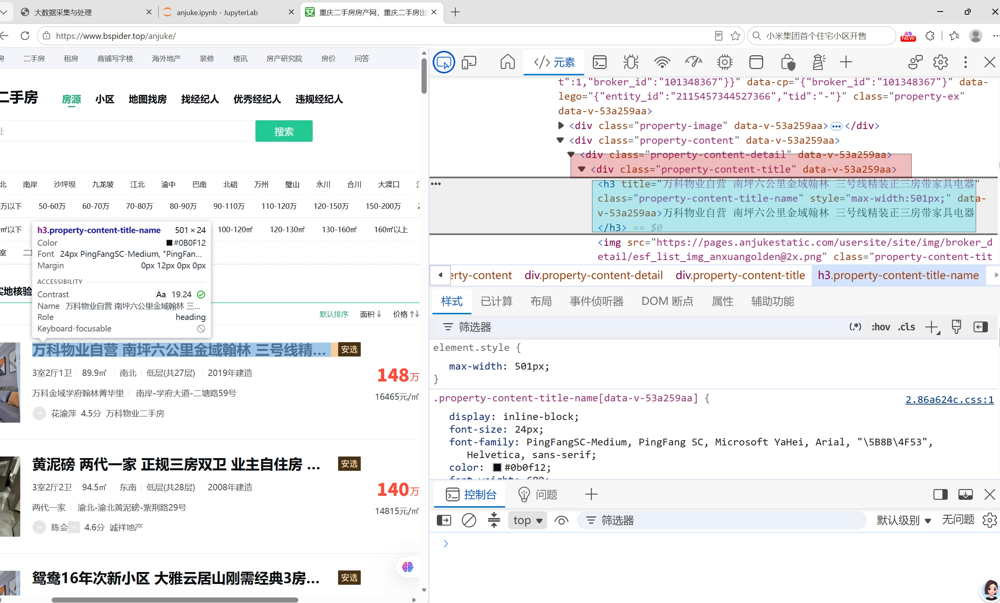

在 Elements 面板逐层展开房源节点，最终定位到标题所在的 `h3.property-content-title-name`，右下角样式面板显示它的字号是 24px。用 Ctrl+F 输入选择器时显示 `1 of 1`，说明在当前页面里这个 class 只对应这一处标题，可以放心用来取标题文字。

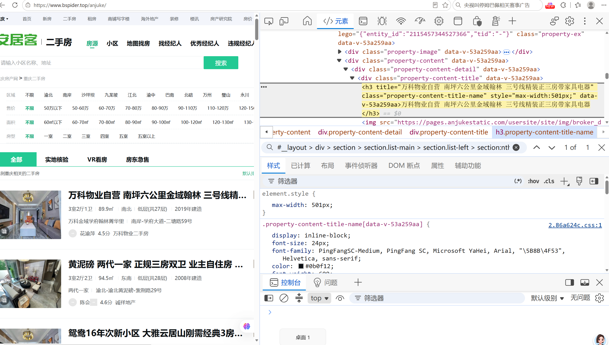

向上找到刚好包住整条房源的 `div.property-content`，鼠标悬浮时网页高亮区域正好覆盖一张卡片（图片、标题、户型面积、地址、总价都在里面）。搜索框显示 `1 of 60`，说明这个 class 在全页有 60 个，正好对应第一页的 60 条房源，因此可以把它当作“一条房源”的根节点。

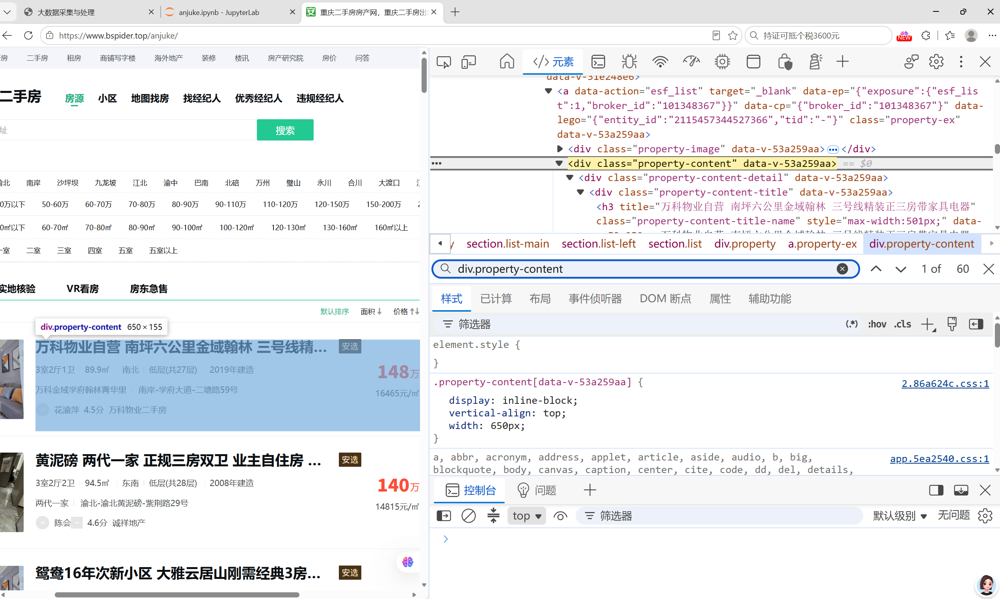

这里对比了 Copy selector 得到的完整路径与筛选器里的匹配结果：完整路径从 `#__layout` 开始，一路带 `section:nth-child(4) > div:nth-child(1)`，靠位置定位第 1 条房源。这种路径只要页面多插一个节点就会失效，所以只保留 `div.property-content` 之后的两三层相对路径。

说明：删掉了哪些层级？怎样确认父容器刚好包含一条房源？

答：其中前 5 层 #__layout > div > section > section.list-main > section.list-left 是整页布局，只框住整个列表区，对定位"一条房源"没有意义，全部删掉；删掉 section:nth-child(4) > div:nth-child(1) 这两层：它们是按数字位置选出来的第 1 条房源；div.property-content 保留下来用于父容器。
在 Elements 面板将鼠标悬浮在父容器节点，网页高亮刚好完整覆盖一套房源；多条房源均复用该 class，以此确认父容器。

#### 解析8个字段

**截图：** 自己编写的解析代码和首条房源的8个字段输出。代码中必须框出：

- `select()` 和 `select_one()`。
- 面积、单价的定位与取值。
- 建造年代的提取和缺失处理。

可分成几张局部截图。另附面积、单价对应的 HTML 节点或网页原文。

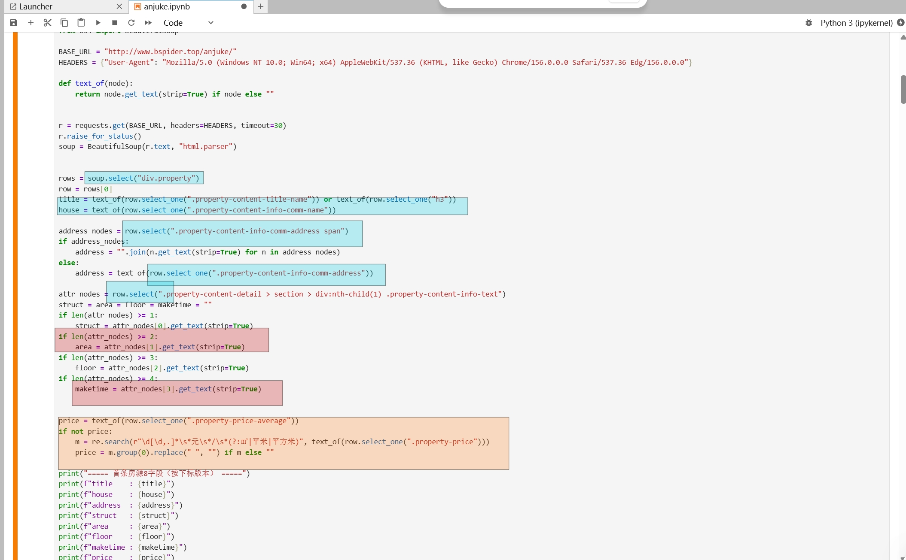

红框是解析主体：`soup.select("div.property")` 取到本页全部房源，`select_one()` 在单条房源内取标题、楼盘和单价，所以取不到会返回 `None`，代码里用 `text_of()` 统一处理空节点。地址用 `select()` 取多个 `span` 后直接拼接，保证地址完整又不在标签之间凭空加空格；属性组 `attr_nodes` 则按下标 `[1]/[2]/[3]` 依次取面积、楼层、年代。这段是初版，下一张截图就是按下标取值的后果。

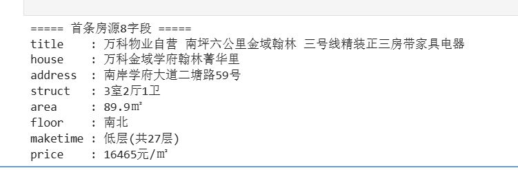

运行后 8 个字段打印出来了，但 `floor` 是“南北”（其实是朝向）、`maketime` 是“低层(共27层)”（其实是楼层），两者正好错位一位。原因是属性组里有“南北”这一项占了下标，按下标取值就会串位，这也印证了讲义里“不能把朝向当成楼层”的提醒。因此后续把属性组改为按文字特征（`\d+室`、`㎡`、`\d{4}年`、`低层/中层/高层`）识别，不再依赖下标顺序，最终 CSV 里的 `floor=低层(共27层)`、`maketime=2019` 是正确的。

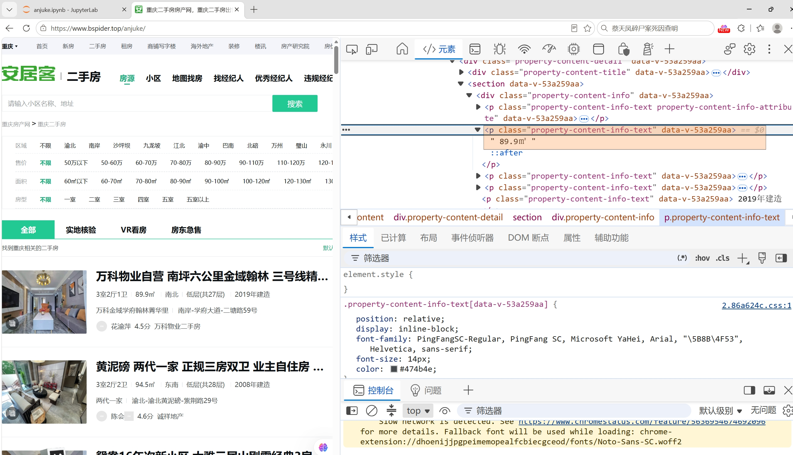

在 Elements 面板点到面积那一项，节点是属性组里的 `p.property-content-info-text`，内容为 `89.9㎡`，同一组里还依次有户型、朝向、楼层、建造年代。可以看到面积自带 `㎡` 单位，因此取值时保留整段文本，只判断是否含 `㎡`，不截数字，避免单位丢失。

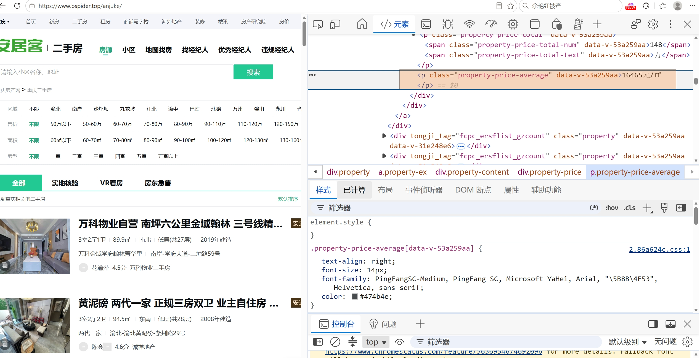

单价在 `p.property-price-average` 里，值为 `16465元/㎡`；同一个 `div.property-price` 下还有 `span.property-price-total-num` 的 `148`，那是“万元”总价。所以代码优先取 `property-price-average` 节点，取不到时再用正则匹配 `元/㎡` 兜底，绝不会把总价当成单价。

说明：两个选择方法各用在哪里？怎样确认面积和单价没有取错？

答：`select()`：返回匹配节点的列表，用于获取全部房源容器 `rows = soup.select("div.property")`，得到页面上所有房源节点集合；也用于获取同一标签下多个子节点，例如地址的多个 span 标签、房源属性组节点。

`select_one()`：只返回第一个匹配的节点，找不到返回 `None`，用于在单条房源 `row` 内部提取标题、楼盘、单价这类唯一字段，每条房源内该字段只会出现一次，配合封装的 `text_of()` 函数避免空节点调用 `get_text()` 引发报错。

确认面积没有取错：
1. 在浏览器 F12 元素面板，点击网页上面积文字，定位到对应的 DOM 节点，核对 class 选择器；
2. 代码拿到属性组节点列表 `attr_nodes`，打印列表全部内容，确认对应的文本就是建筑面积，带有 ㎡ 单位，没有混入户型、楼层内容；
3. 程序输出结果和网页页面文字做肉眼比对，保留单位，不截取数字。

确认单价没有取错：
1. 网页上区分总价（万元）和单价（元/㎡）；优先读取专门存放单价的节点 `.property-price-average`；
2. 兜底正则专门匹配 `元/㎡` 模式的字符串，不会捕获总价；
3. 将解析输出的 price 字段与网页展示的每平米价格逐字符对比，确认单位是 `元/㎡`，不是房源总价格。

### 2. 下一页采集

- 下一页 `href` 原值：?page=2
- 用 `urljoin()` 补全后的地址：http://www.bspider.top/anjuke/?page=2
- 实际停止原因（明确禁用的末页按钮 / 异常中止）：第 10 页页面底部只有“上一页”和 1—9 页码，找不到 `a.next-active` 下一页按钮，判定到达末页，正常终止采集。

**截图：** 框出提取 `href`、补全地址、循环更新地址和停止条件的代码。附前两页的运行日志，以及最终停止提示。离线实验展示快照中的 href、补全结果和文件读取记录，注明“离线回放”，不算在线翻页成功。

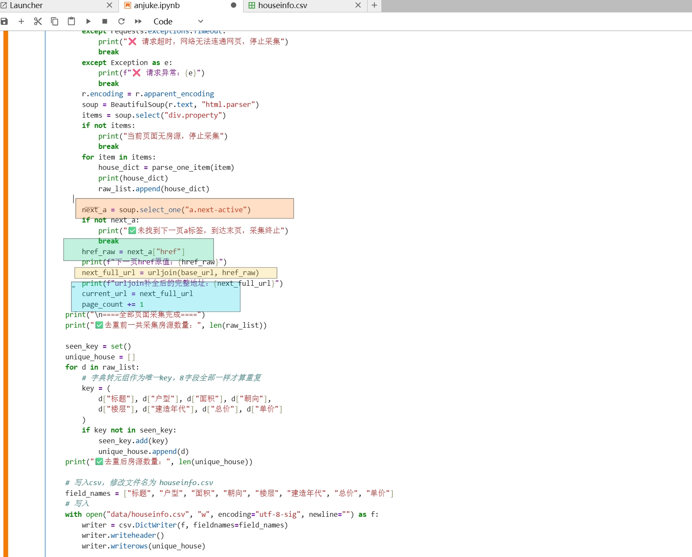

红框是翻页的三步：`select_one("a.next-active")` 定位活动按钮，`next_a["href"]` 取到 `?page=2` 这样的相对地址，`urljoin(base_url, href_raw)` 补全成完整 URL，再赋给 `current_url` 让下一轮循环请求新页。紧接着 `if not next_a: break` 就是停止条件——没有下一页按钮即判定末页；下面的 `seen_key` 集合用 8 个字段组成的元组判重，最后用 `csv.DictWriter` 写入 `data/houseinfo.csv`。

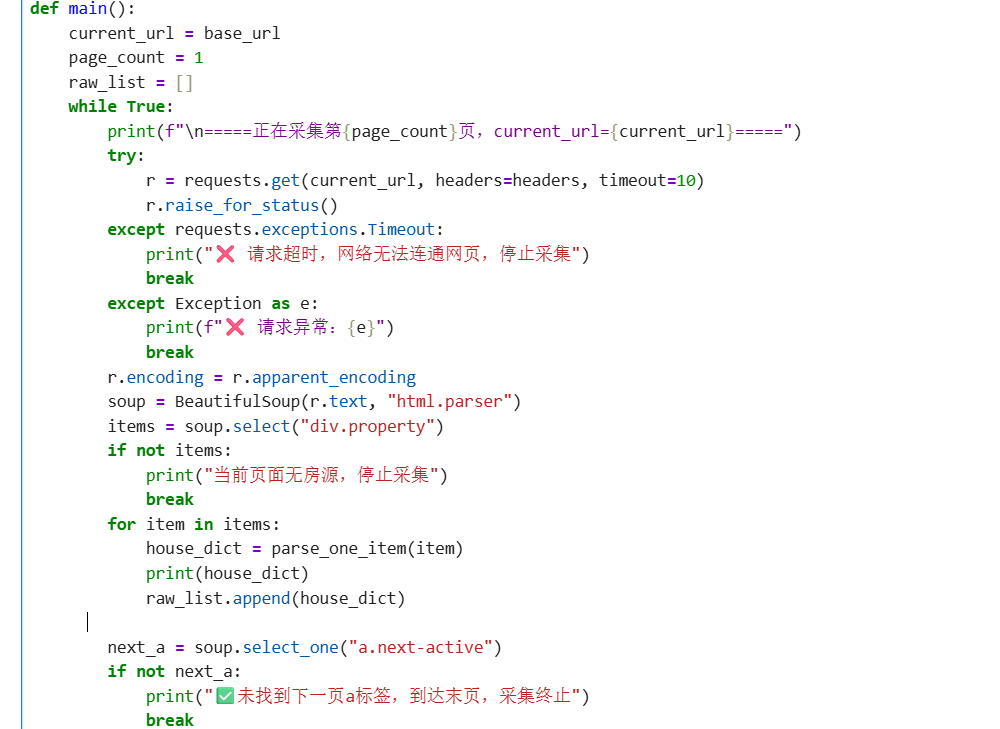

`while True` 里依次完成“请求—校验状态码—解析—累加—找下一页”，`raise_for_status()` 保证 4xx/5xx 立刻报错而不是把错误页当数据解析。超时和请求异常都被 `except` 捕获后 `break`，不会无限重试；本页解析不到 `div.property` 也 `break`，防止把验证页当成空页继续翻。加上每轮只按页面给出的 `next-active` 前进，地址不会越出教学站，也不会回到已访问的页面。

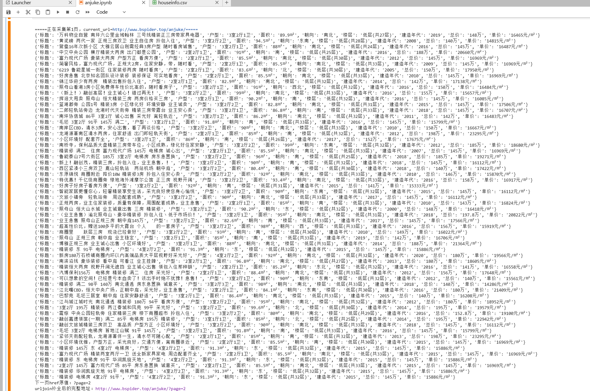

第 1 页日志：开头打印当前页码和 URL，随后每行输出一条房源字典，可以看到 8 个键都取到了值。日志末尾的 `urljoin 补全后的完整地址` 是 `?page=2`，说明本页确实解析出了下一页地址。

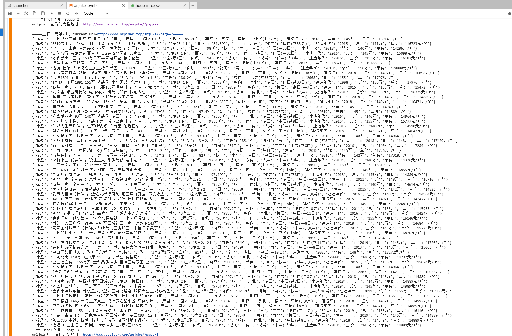

第 2 页日志：请求地址已经变成 `http://www.bspider.top/anjuke/?page=2`，标题与第 1 页完全不同，说明 `current_url` 更新生效、页码递增正常，没有把第 1 页重复采一遍。末尾继续出现 `?page=3`，循环可以持续下去。

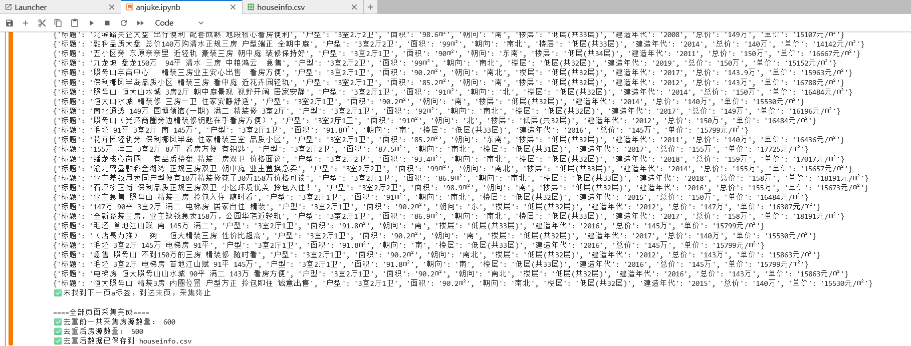

第 10 页采完后输出“未找到下一页 a 标签，到达末页，采集终止”，这就是停止条件的实际表现。随后统计去重前 600 条（10 页 × 60 条），按 8 字段去重后 500 条，并提示已保存到 `houseinfo.csv`；本图是当时那一轮的日志，最终重新跑过一遍并按英文 8 字段去重，落盘结果为 498 条（见下文 CSV 回读截图）。

说明：怎样进入下一页？怎样防止重复采集或无限循环？若中途失败，说明停在哪一步。

答：1. 进入下一页：使用 `select_one("a.next-active")` 定位下一页按钮标签，读取标签 `["href"]` 属性拿到相对路径；通过 `urljoin()` 把基础域名和相对 href 拼接成完整 URL；将完整 URL 赋值给 `current_url`，`while True` 循环下一轮就请求新地址实现翻页。
2. 防止无限循环：依靠网页的 `next-active` 按钮，找不到该标签就 break 退出循环；设置 `requests` 超时捕获网络异常，发生超时、请求异常直接 break 终止，避免死循环。
3. 防止重复采集：采集全部完成后，把每条房源 8 个字段拼成元组放入集合去重；只有元组不在集合内才加入最终结果列表，过滤完全重复的房源。
4. 中途失败处理：如果发生网络超时、请求异常，打印错误信息立刻 break 停止程序，不再继续请求后续页面。

### 3. 保存 CSV

**截图：** CSV保存与回读代码、回读条数。框出编码、表头和数据写入部分。

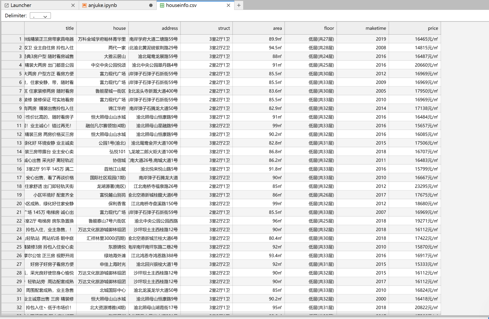

用表格视图打开 `data/houseinfo.csv`，表头正好是要求的 8 个字段 `title,house,address,struct,area,floor,maketime,price`，顺序与建表一致。文件用 `utf-8-sig` 写入，所以直接在 Excel/WPS 里打开中文标题和地址不会乱码。

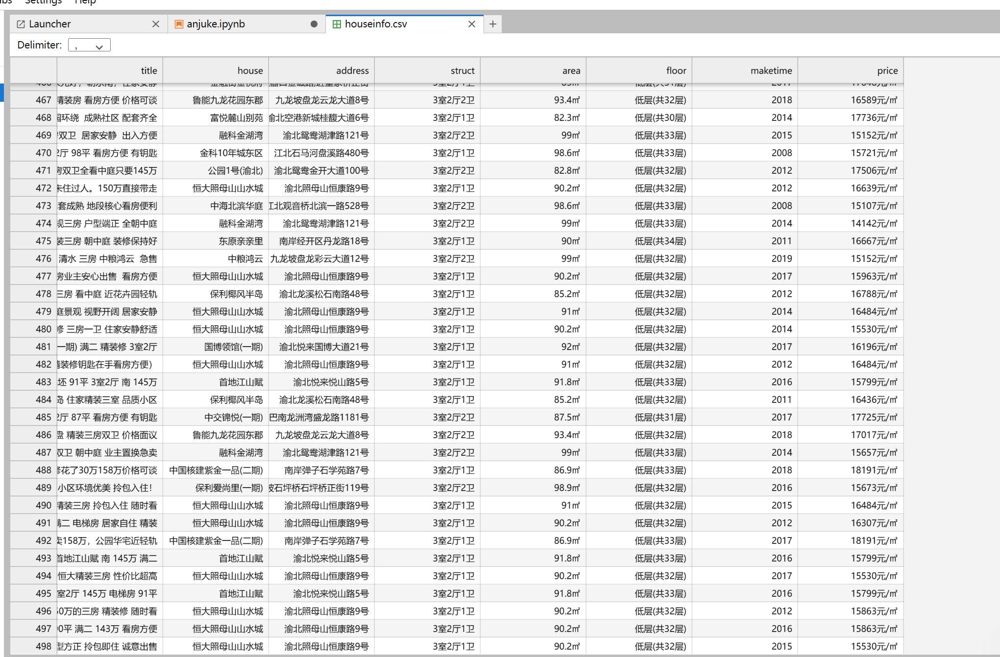

拉到文件末尾，最后一行序号是 498，确认数据行数就是 498 条，没有多余的汇总行或空行。`maketime`、`floor` 两列在这里已经是正确值（如 `低层(共27层)`、`2019`），说明错位问题在最终版本里已经修正。

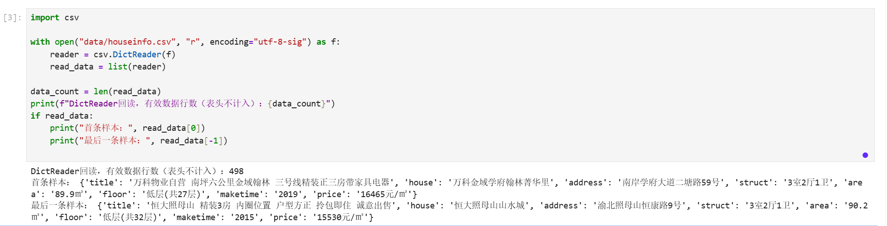

用 `csv.DictReader` 重新读取文件，`len(read_data)` 输出 498，表头没有被算进数据行数。同时打印第一条和最后一条样本，字段与网页原文一一对应，可作为后续入库和逐条核对的依据。

按8个字段完全相同去重后，保存了多少条记录？

答：8 个字段顺序：`title（标题）、house（楼盘）、address（地址）、struct（户型）、area（建筑面积）、floor（楼层）、maketime（建造年代）、price（单价）`。
去重逻辑：把每条房源的 8 个字段拼接成元组，存入集合 `seen_key` 做判重；只有 8 个字段全部内容完全一致才判定为重复记录，重复数据丢弃不写入 CSV。按 8 个字段完全相同去重后，保存了 498 条记录。

## 第三阶段：MySQL 数据存储

### 1. 读取 CSV 并入库

本阶段读取第二阶段的 `data/houseinfo.csv`，不重新采集。

**截图：** 框出读取CSV、按8个字段整理入库参数的代码。

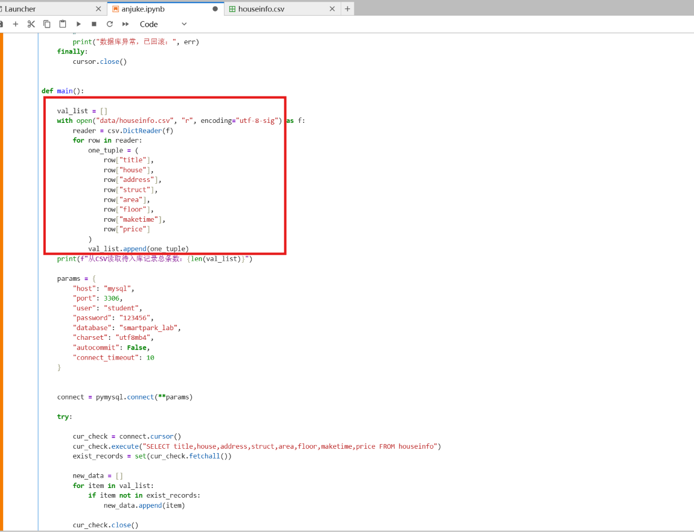

红框部分用 `csv.DictReader` 逐行读取，严格按 `title、house、address、struct、area、floor、maketime、price` 的顺序组装成 8 元组，元组顺序与后面 INSERT 里的 8 个 `%s` 一一对应。读取完成后先打印 `val_list` 总数（498）确认条数，再建立连接参数：`host="mysql"`、`port=3306`、`user="student"`、`autocommit=False`，事务由程序自己提交。

**截图：** 自己编写的入库代码。框出 `executemany()`、`commit()`、`rollback()`，以及关闭游标和连接的操作。另框出避免重复插入的代码。

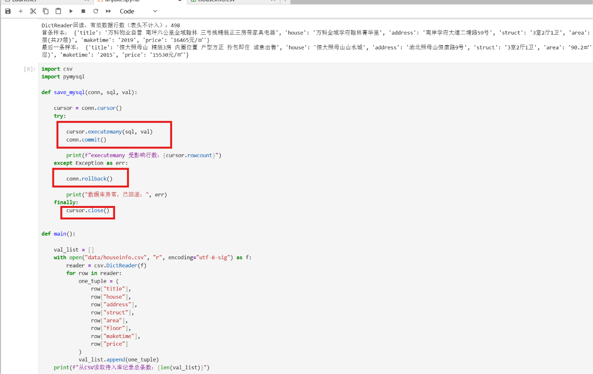

`save_mysql()` 里三个红框分别是 `cursor.executemany(sql, val)` 批量写入、`conn.commit()` 提交、异常时 `conn.rollback()` 回滚，`finally` 中再 `cursor.close()` 释放游标。这样正常路径“写入→提交”，异常路径“回滚→打印错误”，两条路都不会把半截数据留在库里。

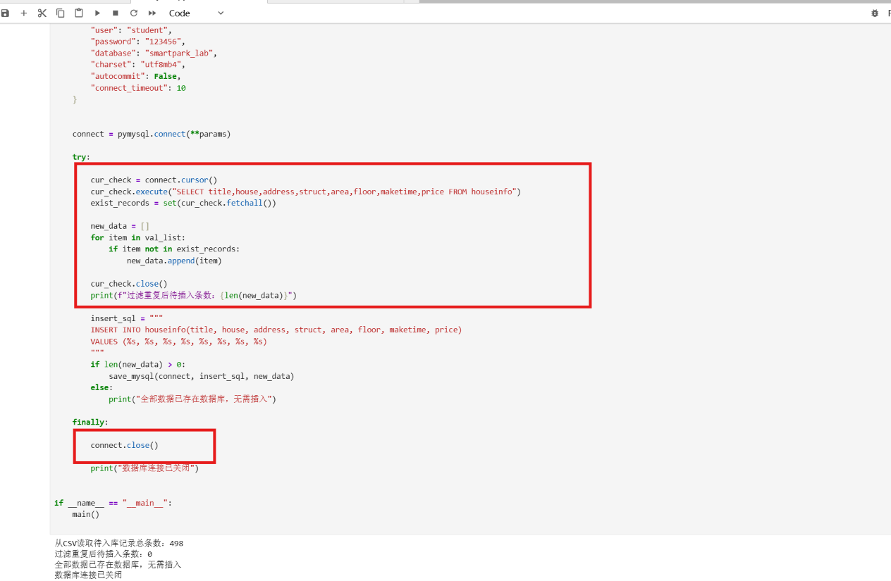

大框是先查库再判重：`SELECT title,house,... FROM houseinfo` 把库里已有的 8 字段取成集合 `exist_records`，只把不在集合里的记录放进 `new_data`，避免重跑时重复插入。`if len(new_data) > 0` 才执行插入，否则提示“全部数据已存在数据库”，最后在 `finally` 里 `connect.close()` 关闭连接；控制台输出“过滤重复后待插入条数：0”“数据库连接已关闭”，说明重跑是安全的。

说明：每条记录怎样对应8个参数？成功、失败时分别做什么？再次运行时怎样避免重复插入？

答：1. 每条记录对应 8 个参数
使用 `csv.DictReader` 读取 CSV 的每一行 `row`，严格按照建表与 INSERT 语句字段顺序：`title、house、address、struct、area、floor、maketime、price`，依次取出 `row["字段名"]` 组装成 8 个元素的元组 `one_tuple`。元组内 8 个值的顺序和 SQL 语句里 8 个 `%s` 占位符一一对应，多条元组组成列表传给 `executemany()`，完成参数绑定。
2. 成功时做什么
数据读取、参数组装无误后，调用 `cursor.executemany()` 执行批量插入；执行完成调用 `conn.commit()` 提交事务，数据才真正持久化写入 MySQL；最后在 `finally` 中关闭游标，关闭数据库连接，释放资源。
3. 失败时做什么
程序捕获数据库异常，执行 `conn.rollback()` 事务回滚，撤销本次事务中尚未提交的全部修改，不会写入脏数据；打印异常提示信息；进入 `finally`，依然关闭游标、关闭数据库连接，释放数据库资源。
4. 再次运行避免重复插入
插入之前先查询数据库表中已有的 8 个业务字段，将查询结果存入集合 `exist_records`；遍历 CSV 解析得到的数据元组，判断元组是否存在于集合中，只有数据库不存在的记录才加入待插入列表 `new_data`。只对过滤后的新数据执行插入，不采用清空数据表的方式，实现重复运行脚本不会产生重复房源。

### 2. 核对结果

#### 查询条数和样本

**截图：** MySQL 终端中的入库前后 `SELECT COUNT(*)`、重跑后的条数，以及 `SELECT ... LIMIT 5` 的结果。

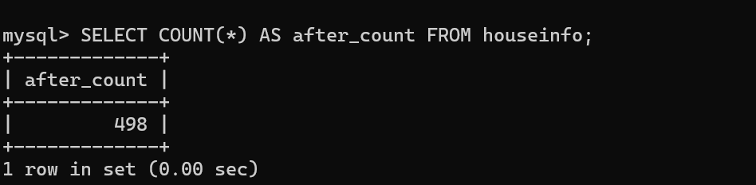

入库后在 MySQL 终端执行 `SELECT COUNT(*) AS after_count FROM houseinfo;`，结果为 498。这个数字与 CSV 回读的 498 行完全一致，说明这批数据没有漏插也没有多插。

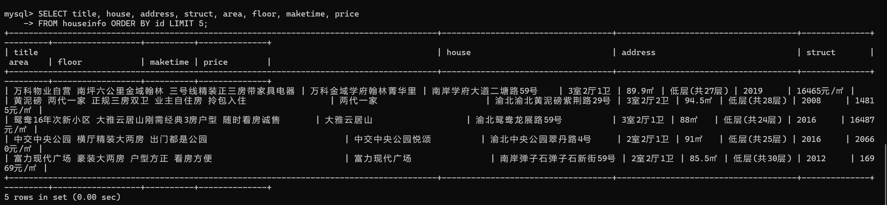

按 `id` 升序取前 5 条，8 个字段都有值：`area` 保留 `㎡`、`price` 保留 `元/㎡`、`maketime` 是四位年份、`floor` 是“低层(共X层)”而不是朝向。字段格式与 CSV 完全对应，说明入库过程没有做任何改写。

| 项目 | 实际结果 |
|---|---|
| 成功采集页数 |10 |
| 采集记录数（去重前） |600|
| 完全相同的重复记录数 |102|
| CSV数据行数（不含表头） |498|
| 入库前条数 |0|
| 入库后条数 / 本次新增条数 |498 / 498|
| 关闭上次程序后，同批数据独立重跑的条数 / 新增条数 |498 / 0|
| 是否采集完整；未完成的原因 |已完成|

说明：首次入库后的条数应等于去重后的CSV数据行数，8个字段的内容也应一致。若不一致，说明原因。总条数以实际结果为准。

答：首次入库后的条数等于去重后的CSV数据行数，均为 498 条，8 个字段内容一一对应、保持一致。
入库代码读取 CSV 中的每一行，按 `title、house、address、struct、area、floor、maketime、price` 八个字段顺序组装元组，通过 `executemany` 批量写入数据库；入库前已经按照八个业务字段做重复校验，仅将不存在于数据库的有效记录插入，因此入库后总记录数和去重后的 CSV 行数相等，八个字段内容和源 CSV 保持一致。
如果二者条数不一致，可能原因：①CSV 存在空行、字段缺失；②数据库插入时触发异常、部分批次回滚；③判重逻辑字段选取不一致；④CSV 编码问题导致部分行读取失败。本次实验无上述问题，数据匹配。

#### 逐条核对

选取第一条、跨页一条和最后一条，比较网页、CSV 与数据库中的 8 个字段。快照实验对照教师提供的网页文件。

**截图：** 三条样本的对照结果，框出面积、单价和年代。可分图。

样本 1：第 1 页第 1 条（`万科物业自营 南坪六公里金域翰林 三号线精装正三房带家具电器`）

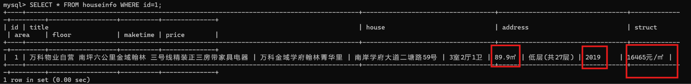

数据库里 `id=1` 这条记录，红框标出的 `89.9㎡`、`2019`、`16465元/㎡` 就是要重点核对的面积、建造年代和单价。这三个值恰好是最容易取错的三项：面积容易混入朝向、年代容易取成楼层、单价容易取成总价。

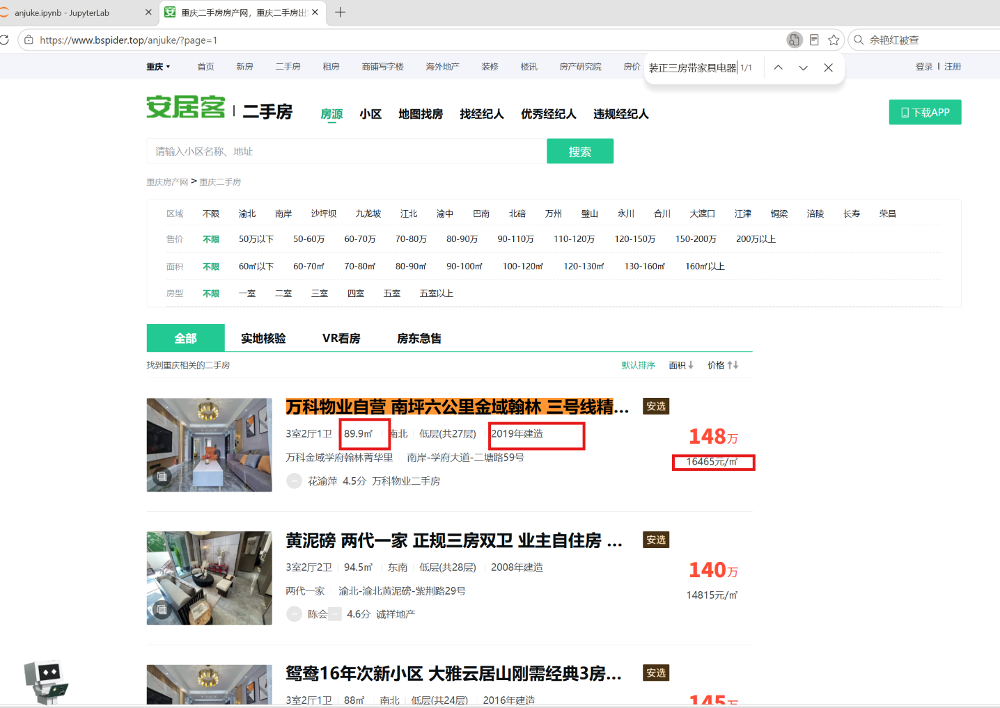

在浏览器按 Ctrl+F 搜标题定位到同一条房源，网页上显示的就是 `89.9㎡`、`2019年建造`、`16465元/㎡`，与数据库完全对应。注意这条房源右侧的 `148万` 是总价，没有被写进 `price`。

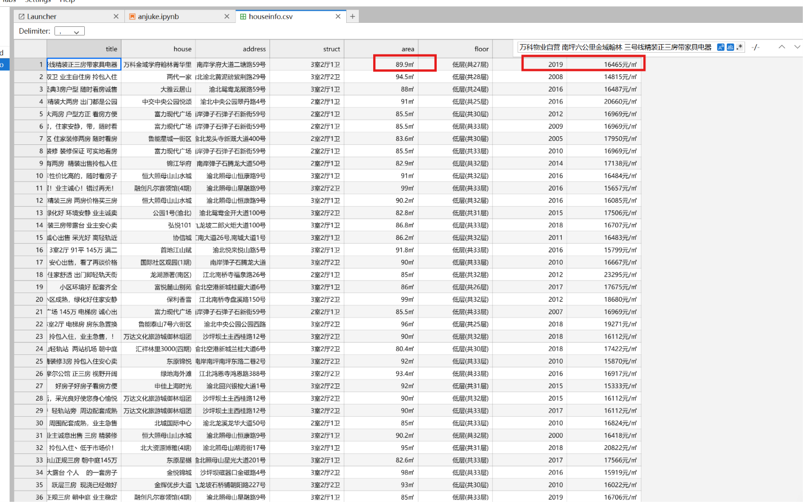

CSV 第 1 行（表格视图第 2 行）同样是 `89.9㎡`、`2019`、`16465元/㎡`。三个来源逐字段一致，第一条样本核对通过。

样本 2：第 4 页中间一条（`豪华装修朝中庭户型，带车位价格，居家非常安静，成熟地段位置！`，跨页样本）

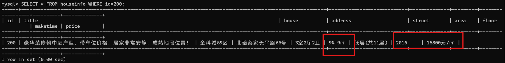

数据库中 `id=200` 的记录，红框是 `94.9㎡`、`2016`、`15800元/㎡`。取 `id=200` 而不是第 200 行数据，是因为 `id` 由数据库自增生成，不会因重跑改变，定位更稳。

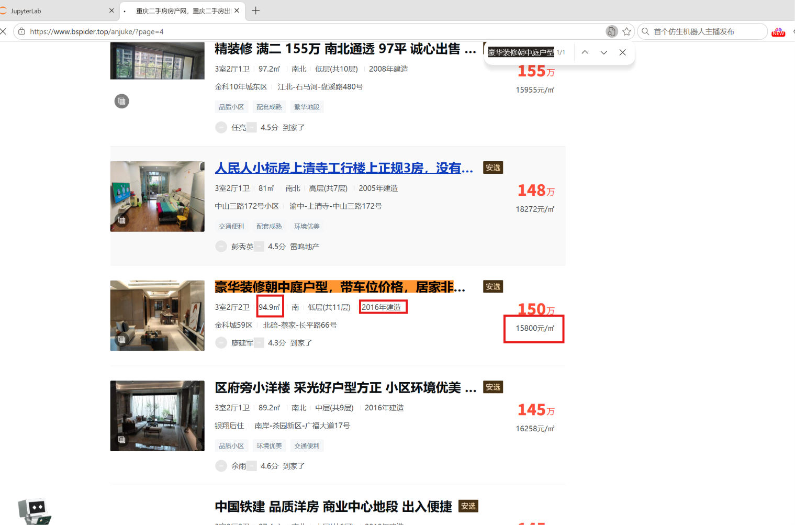

第 4 页（`?page=4`）搜索标题定位到这条房源，网页原文为 `94.9㎡`、`2016年建造`、`15800元/㎡`，与数据库记录一致。这条是从第 4 页采到的，说明跨页数据也正确入库，不只是第一页。

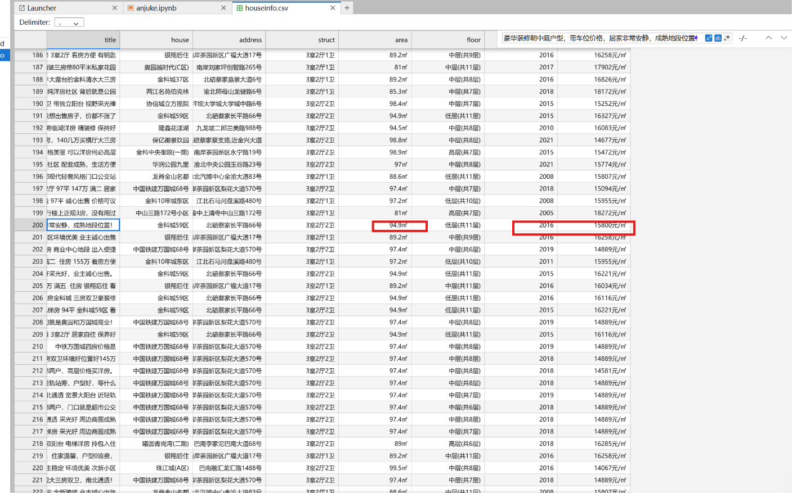

CSV 第 200 行同样是 `94.9㎡`、`2016`、`15800元/㎡`。样本 2 三处一致，核对通过。

样本 3：第 10 页最后一条（`恒大照母山 精装3房 内圈位置 户型方正 拎包即住 诚意出售`）

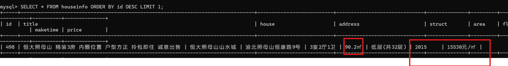

`SELECT * FROM houseinfo ORDER BY id DESC LIMIT 1;` 取到最后一条记录，`id=498`，红框为 `90.2㎡`、`2015`、`15530元/㎡`。这条既是最后入库的记录，也是末页的最后一条，可以同时验证末页采集是否完整。

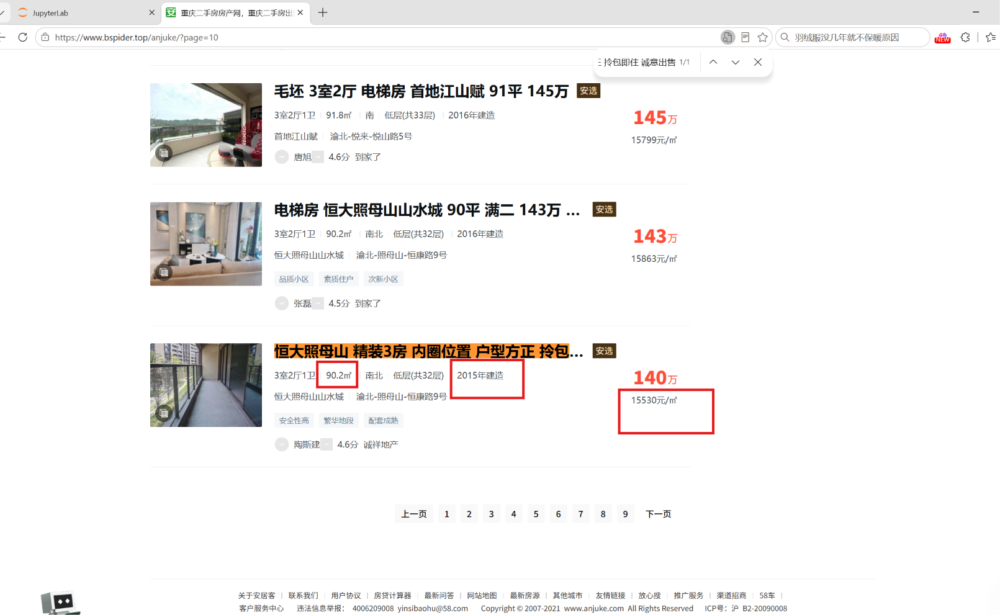

第 10 页页面底部显示“上一页 + 1—9 页码”而没有“下一页”，这就是判定的末页；该页最后一条房源网页原文为 `90.2㎡`、`2015年建造`、`15530元/㎡`，与数据库一致。

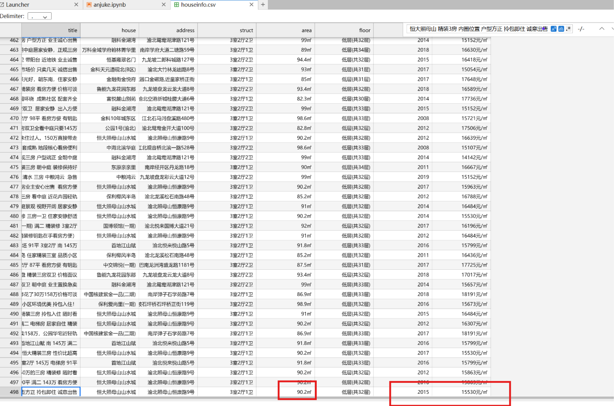

CSV 第 498 行（文件最后一行）也是 `90.2㎡`、`2015`、`15530元/㎡`。样本 3 三处一致，三条样本全部核对通过。

- 样本1（页码或URL、记录位置）：第1页，第1条记录
- 样本2（页码或URL、记录位置）：第4页，中间一条记录（跨页样本）
- 样本3（页码或URL、记录位置）：第10页，最后一条记录

核对结论及差异：选取第 1 页首条、第 4 页中间跨页记录、第 10 页末尾记录共 3 组样本，对照网页、CSV 文件、MySQL 数据库中的 8 个字段（title、house、address、struct、area、floor、maketime、price），重点比对面积、建造年代、单价。三组样本在三处来源的字段内容完全一致，无内容差异。

## 问题与解决

- 遇到的问题、处理方法及结果：①属性组按固定下标取值时，出现 `floor` 取成“南北”、`maketime` 取成“低层(共27层)”的错位（见首条房源输出截图）；改为按文字特征用正则识别（`\d+室` 判户型、`㎡` 判面积、`\d{4}年` 判年代、`低层/中层/高层` 判楼层），不再依赖顺序，重新采集后 `floor` 与 `maketime` 均正确。②单价节点同时存在总价与均价，误取会得到“148万”；改为只读 `.property-price-average`，并用 `元/㎡` 正则兜底。③首次入库后重跑会产生重复数据；改为入库前先查库内 8 字段集合判重，只插入新记录，重跑时新增 0 条。
- 尚未解决的问题、未完成的步骤：无。

## 思考题

1. 本次怎样实现下一页采集？结合自己的代码说明。

   答：爬虫循环采集页面，每次解析完当前页面房源数据后，定位页面的下一页按钮元素；判断下一页按钮是否存在、是否可以点击。如果下一页元素存在，提取下一页的链接，发起请求访问下一页，继续解析数据；如果找不到下一页按钮，代表已经到达最后一页，循环终止，结束采集。具体到代码，`href = next_a["href"]` 取到 `?page=2` 这样的相对地址，`urljoin(base_url, href)` 补全成完整 URL，赋给 `current_url` 后由 `while True` 的下一轮请求；循环里另有安全页数上限、超时与空列表 `break`，防止异常情况下无限翻页。

2. 旧代码把 out_list 定义在全局。你把结果列表放在哪里？为什么？

   答：存放采集结果的列表（`val_list`、`raw_list`）定义在采集函数 `main()` 内部，属于局部变量，不使用全局变量。
   原因：①局部变量作用域仅在当前函数内，不会污染其他代码、避免全局变量被多处意外修改；②多次调用采集函数时，每次都会生成全新空列表，不会出现上次采集的数据残留叠加；③代码封装性更好，便于调试，符合模块化编程规范。

3. 你怎样获取建造年代？节点缺失或顺序改变时，怎样处理？

   答：通过属性组节点 `.property-content-info-attribute .property-content-info-text` 取出所有文本项，用正则 `\d{4}\s*年` 匹配含四位年份的那一项作为 `maketime`，取到后不带“年”字直接存年份（如 `2019`）。
   处理方案：不再按固定下标取值，顺序变化不会串位；若整组都不匹配，`maketime` 保持空字符串并继续处理下一条房源，程序不会因为单条数据缺项而中断。

## 提交检查

- [] 实验一原仓库的 `lab02/` 中已有源码、CSV、报告和真实截图。
- [] 截图清楚，关键代码已框出，每项附有个人解释。
- [] GitHub上能打开文件和图片，未上传个人账号密码、`.env`或教师答案。
- [] 未完成项已如实说明；学习通只交原仓库链接。

如使用 AI，简述它帮助了什么，以及自己修改、运行和核对了什么：使用 AI 辅助检查报告与讲义要求的对应关系、整理截图目录并润色截图说明文字；选择器定位、解析代码、翻页与入库程序均在自己的 JupyterLab 环境运行，字段错位问题由本人运行输出发现并改为按文字特征识别，CSV 498 行与数据库 498 条的核对结果为本人实际执行。
